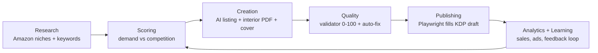

# KDP Automation Studio

**An end-to-end Streamlit app that takes an Amazon KDP book from niche research to a print-ready paperback: listing, interior PDF, cover, quality check and assisted upload.**

Built for publishers producing low- and medium-content books (journals, planners, puzzle books, cookbooks, activity books) at scale, without giving up control over the final publish step.

## Pipeline



## Modules

| Module | What it does |
|---|---|
| `research/` | Scrapes Amazon search results with polite delays, scores niches (competition 45 %, demand 40 %, pricing 15 %), keeps history and an autopilot that ranks opportunities |
| `intelligence/` | Keyword tower and keyword opportunity finder, category optimizer, competitive and market analysis, cover research, performance predictor and recommender |
| `creation/` | Claude-generated listings (title, subtitle, description, 7 keywords), ReportLab interior PDFs at exact KDP trim and bleed specs, cover generator with spine width computed from page count and paper type, EPUB builder, A+ content, 3D book mockups, A/B hooks |
| `creation/puzzles/` | 9 algorithmic puzzle generators: mazes, word search, sudoku, cryptogram, logic grid, nonogram, kakuro, KenKen, dot-to-dot. Seeded so every book is unique but reproducible, with solution pages |
| `creation/highcontent/` | Engine for longer non-fiction books with rendered infographics |
| `quality/` | Validator scoring each book 0-100 (margins, page count, fonts, metadata, cover dimensions), automatic fixes and daily reports |
| `publishing/` | Playwright session with saved login, fills the KDP draft form and uploads files. The user logs in and clicks **Publish** themselves |
| `analytics/` | Imports KDP sales reports and Amazon Ads data, ACOS and per-book reports |
| `learning/` | Multi-signal feedback loop: learns from edits, ratings and sales to bias the next generations |
| `marketing/` | ARC (advance review copy) reader tracker |

## Tech stack

Python · Streamlit · Anthropic Claude API · OpenAI (optional cover images) · ReportLab · fpdf2 · Pillow · Playwright · BeautifulSoup · pandas · EbookLib

## Quick start

```bash
git clone https://github.com/AlfaOtto/kdp-automation-studio.git
cd kdp-automation-studio
bash setup.sh                 # venv, packages, Chromium, .env from template
# edit .env: ANTHROPIC_API_KEY (required), OPENAI_API_KEY (optional)
source venv/bin/activate
streamlit run app.py
```

The interface labels are in French; generated books and listings are in English.

## Design principles

- **Exact print specs**: trim sizes, bleed, margins and spine width follow KDP rules, so files pass KDP review on first upload.
- **Human in the loop**: the bot prepares and fills everything, but the account owner logs in and confirms publication.
- **Deterministic content**: puzzle books are generated from seeds, so no two books duplicate each other.
- **No secrets in code**: keys live in `.env` (ignored by git); sessions and outputs stay local.

## Services

I build custom Python automations, AI content pipelines, scrapers and Streamlit dashboards. Contact me on Upwork.
